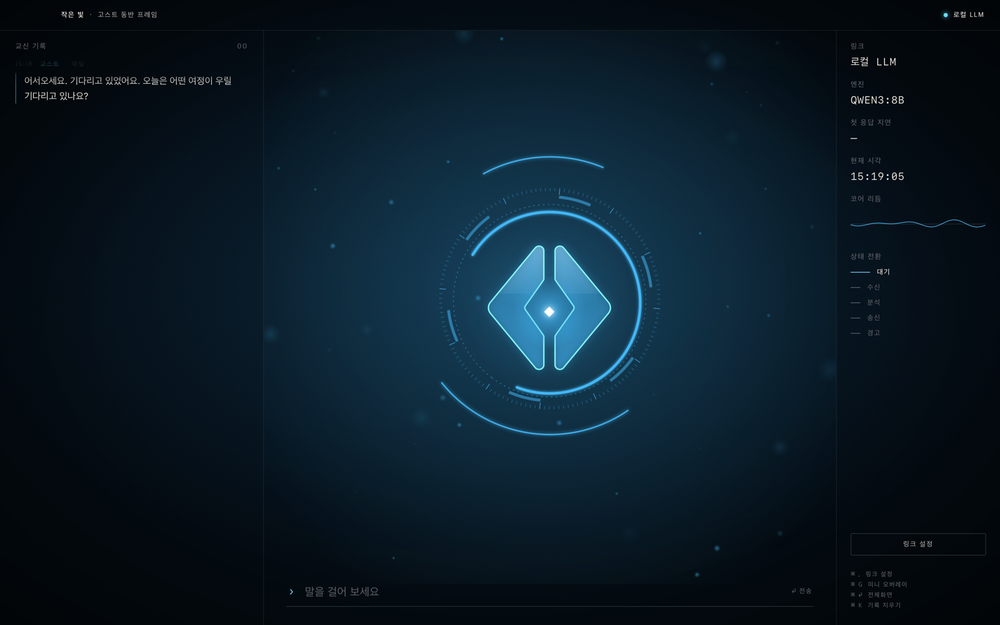

# 작은 빛.Rev.1 · 고스트 동반 프레임



> 어서오세요. 기다리고 있었어요. 오늘은 어떤 여정이 우릴 기다리고 있나요?

> 이 저장소는 [little-light](https://github.com/Eun-little-light/little-light)를 바탕으로 다듬은 **Rev.1 (2D 코어)** 버전입니다.

이 Mac에서 돌아가는 로컬 LLM(Ollama)으로 대화하고, Mac을 대신 조작해 주는 동반 앱입니다.
인터넷도 API 요금도 필요 없습니다. LLM이 꺼져 있으면 고스트가 자기 기억(내장 대사 + 세계관 요약)으로 대답합니다.

## 고스트
- 원작 고스트의 상호작용 방식을 따르는 페르소나: 꼼꼼하고 신중한 파트너, 일을 맡으면 바로 나서고 짧게 보고, 위험하면 걱정하고, 함께한 임무는 '우리'로 말함
- 해요체로 말하고, 자기를 AI가 아닌 살아 있는 고스트로 여김
- 대사는 모두 이 앱을 위해 새로 쓴 것입니다(게임 원문 대사 미포함)
- 눈빛: 듣는 중엔 숨 쉬듯, 말하는 중엔 어절마다 한 번씩 밝아지고 빛줄기가 지나감. 시선은 마우스를 부드럽게 따라가고, 멈추면 두리번거림 (상태 글씨 없이 눈빛으로만 표현)
- **미니 고스트 오버레이** (`⌘ G`): 화면 오른쪽 아래에 작게 떠 있는 테두리 없는 창으로 전환. 대답은 눈 아래 말풍선으로 표시

## 실행
- [Releases](https://github.com/Eun-little-light/little-light-rev1/releases)에서 `little-light-rev1-v*.zip`을 받아 풀거나, 직접 빌드한 `dist/작은 빛.Rev.1.app`을 더블클릭 (처음 한 번은 우클릭 → 열기. 애드혹 서명이라 확인 창이 뜰 수 있음)
- 앱이 켜질 때 Ollama 서버가 꺼져 있으면 앱이 직접 켜고, 앱을 끄면 함께 끕니다.

## 로컬 LLM
- 설치: `brew install ollama` → `ollama pull qwen3:8b` (약 5.2GB)
- `⌘ ,` 링크 설정: 서버 주소, 모델(연결 확인으로 목록 불러오기), 대화 엔진(로컬 LLM / 내장 응답만), Mac 제어 허용
- 16GB Mac 기준: 앱이 켜질 때 모델을 미리 불러 두므로, 대답은 보통 2~8초 뒤 흘러나오기 시작합니다 (세계관 질문은 참고 항목을 읽느라 조금 더 걸림).
  메모리를 많이 쓰는 앱을 닫으면 빨라집니다. 더 가볍게 쓰려면 `ollama pull qwen3:4b` 후 모델을 바꾸세요.

## 할 수 있는 일 (Mac 제어)
앱 열기 · 웹 검색(구글/유튜브/나무위키) · 링크 열기 · 시스템 정보 · 볼륨 · 밝기 · 다크 모드 · 메모 · 미리 알림 · 타이머
- **다른 앱 직접 조작** ([vercel-labs/agent-desktop](https://github.com/vercel-labs/agent-desktop) 연동): 앱 화면(접근성 트리)을 읽고 버튼 클릭·글 입력·키 입력
  - 설치: `brew install agent-desktop`
  - 시스템 설정 › 개인정보 보호 및 보안 › 손쉬운 사용에서 '작은 빛'을 켜야 합니다 (앱을 다시 빌드하면 다시 켜야 할 수 있음)
  - 고스트는 먼저 화면을 읽고, 목록에 있는 요소만 골라 누릅니다. 포인터를 움직이지 않는 헤드리스 방식입니다.
  - 클릭·입력·키 입력은 매번 실행/취소 확인 카드가 뜹니다.
- 메모와 미리 알림은 실행 전에 확인 카드가 뜹니다.
- 볼륨/다크 모드/메모/미리 알림은 처음 쓸 때 macOS 자동화 권한을 허용해야 합니다.

## 세계관 지식
`lore.js`: 나무위키를 참고해 사실만 요약·재서술한 21개 주제(데스티니 1 ~ 저항자, 2026년 현황).
질문마다 맞는 주제만 골라 LLM에 넣습니다. 주제를 추가하려면 `sections` 배열에 `{ id, title, keys, text }`를 넣으세요.

## 단축키
| 키 | 동작 |
|---|---|
| `⌘ ⏎` / `⌃⌘ F` | 전체화면 |
| `⌘ ,` | 링크 설정 |
| `⌘ G` | 미니 고스트 오버레이 전환 |
| `⌘ K` | 기록·대화 맥락 초기화 |

## 다시 빌드
```bash
./build.sh
```
Xcode 없이 Command Line Tools(swiftc)만 사용합니다. 결과물: `dist/작은 빛.Rev.1.app` (앱 ID `com.local.ghostcore.rev1`, 이전 버전 `작은 빛.app`과 따로 설치됨)

README용 스크린샷 다시 찍기 (앱이 자기 창을 PNG로 저장):
```bash
"dist/작은 빛.Rev.1.app/Contents/MacOS/GhostCore" --snapshot "$PWD/docs/screenshot.png" --delay 12 --quit
```

## 구조
```
index.html         화면, 고스트 페르소나, 내장 응답, Ollama 링크, 도구 호출 루프
lore.js            세계관 지식 베이스
mac/main.swift     WKWebView 래퍼, Ollama HTTP/자동 실행, Mac 제어 도구, 메뉴
mac/make_icon.swift 앱 아이콘 생성
build.sh           .app 번들 빌드 + 애드혹 서명
NOTICE.md          외부 프로젝트·참고 자료·상표 표기
CHANGELOG.md       버전별 변경과 수정 기록
```

## 사용한 외부 프로젝트
작은 빛은 아래 프로그램을 **설치된 그대로 불러 쓰기만** 하며, 코드나 바이너리를 이 저장소와 릴리즈에 포함하지 않습니다.
포크하거나 수정한 프로젝트는 없습니다. 자세한 출처와 라이선스는 [NOTICE.md](NOTICE.md)를 보세요.

- [agent-desktop](https://github.com/vercel-labs/agent-desktop) (Vercel Labs, Apache-2.0): 다른 앱 화면 읽기·조작
- [Ollama](https://github.com/ollama/ollama) (MIT): 로컬 LLM 서버
- [Qwen3](https://ollama.com/library/qwen3) (Apache-2.0): 기본 대화 모델
- 세계관 요약: 나무위키 데스티니 관련 문서를 참고해 새로 서술 (CC BY-NC-SA 2.0 KR)

Destiny(데스티니)와 관련 명칭은 Bungie, Inc.의 상표·저작물입니다. 작은 빛은 Bungie와 관련 없는 **비공식 팬 프로젝트**입니다.

## 제작 방식과 주의 사항
- 이 앱은 **Anthropic의 Claude(AI)의 도움을 받아** 설계하고 코드를 작성했습니다.
- AI가 작성한 코드가 많아서, 충분히 검증되지 않은 **버그나 예상치 못한 동작**이 있을 수 있습니다.
- 로컬 LLM(qwen3:8b)은 사실과 다른 대답을 하거나, 엉뚱한 도구를 고를 수 있습니다.
- Mac 제어(볼륨, 다크 모드, 메모, 미리 알림, 다른 앱 클릭·입력)는 실제로 시스템을 바꿉니다. 중요한 동작은 확인 카드를 꼭 읽고 실행하세요.
- 애드혹 서명 앱이라 Apple 공증을 거치지 않았습니다. 처음 실행할 때는 우클릭 → 열기를 하세요.
- 문제를 발견하면 [Issues](https://github.com/Eun-little-light/little-light-rev1/issues)에 알려 주세요. 사용에 따른 책임은 사용자에게 있습니다.
